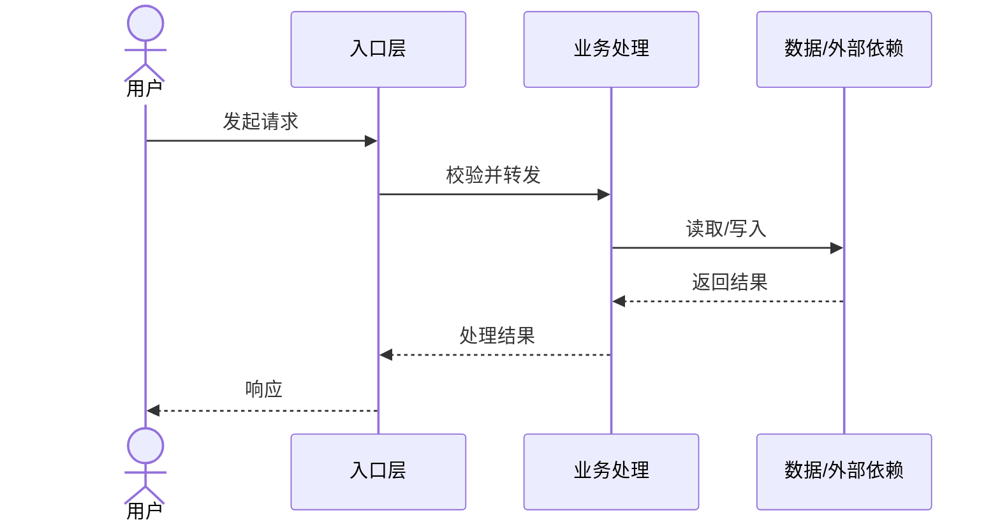

# 概要设计

**项目名称**：XXX项目
**作者**：<动态获取>
**日期**：<当前日期>
**版本**：<动态生成>

## 变更日志

| 版本 | 日期 | 作者 | 变更内容 |
|------|------|------|----------|
| <动态生成> | <当前日期> | <动态获取> | 初始版本 |

> **使用规则（生成时删除本引用块）：**
> 1. 章节固定为以下十二章，不得自由增删；本次不涉及的章节保留标题，显式写"本次无变更/不适用"及一句理由。
> 2. 面向评审人员、架构师、项目经理：禁止代码片段、伪代码、变量名、方法签名。
> 3. 内容归属：接口契约归 05-API文档、数据库变更归 04-数据库设计、测试用例与实测项归 06-测试计划，本文档不写，也不设对应章节。
> 4. 除"十二、待确认事项"外，全文禁止出现"待确认/待补充/待实测"字样；所有决策按确认门禁的已确认结论编写。
> 5. 示例与技术栈无关，参与者、模块、图表形式按项目实际情况替换。

## 一、文档信息

| 项目 | 内容 |
|------|------|
| 需求名称 | <需求名称> |
| 需求来源 | <迭代/需求清单出处> |
| 涉及仓库 | <仓库路径与分支，标注本次是否改动> |
| 预估工作量 | <如有> |

## 二、需求背景与目标

[业务痛点、本次目标；可附代码现状给出的关键结论]

## 三、需求范围

### 3.1 本次实现（功能点清单）

| 序号 | 功能点 | 说明 | 涉及端 |
|------|--------|------|--------|
| 1 | <功能点> | <说明> | <前端/后端/...> |

### 3.2 不在本次范围

- [明确排除项及理由]

## 四、现状分析

[既有实现、可复用能力盘点、限制条件；关键结论附代码位置（文件:行号），不臆造]

## 五、总体方案

### 5.1 候选方案对比

| 序号 | 方案 | 优点 | 缺点 | 结论 |
|------|------|------|------|------|
| 1 | <方案> | <优点> | <缺点> | <采用/不采用> |

### 5.2 选型结论与理由

[采用方案及理由；理由须与代码现状、工作量约束对应]

### 5.3 整体架构图

[mermaid flowchart 或文本架构图；标注本次改动点]

## 六、模块划分与结构关系

### 6.1 模块职责

| 模块名 | 职责 | 关键依赖 |
|--------|------|----------|
| <模块> | <职责描述> | <依赖模块> |

### 6.2 结构关系

[类图/组件图/模块关系，按实际技术栈选择表达形式；体现模块职责与依赖方向，避免仅罗列文件名]

## 七、核心流程概要

### 7.1 主流程时序图（必填）

[参与者按实际架构替换；仅保留端到端主链路（5-9 个关键交互）]

### 7.2 时序点说明（建议逐条填写）

1. 触发条件：谁在什么场景下发起。
2. 前置校验：权限、参数、数据状态、并发/幂等规则。
3. 关键写操作：哪些数据被修改，是否记录变更前版本。
4. 分支策略：关键分支如何处理。
5. 返回契约：成功/失败返回结构与错误码（概述级，字段细节归 05）。

### 7.3 长流程处理（流程过长时必填其一）

当完整流程较长时，不要求把所有细节都画在一张图里，优先展示"本次改动影响的时序点"：
1. 主时序图：仅保留端到端主链路。
2. 改动时序图：单独新增"变更点子流程图"，只画新增或修改的调用链。
3. 注释标记：在图中用 `Note over` 明确"新增/调整/兼容旧逻辑"位置。
4. 差异说明：在图下补充"改动前 -> 改动后"两到三条对照说明。

## 八、交互设计

[入口位置、文案、状态提示（进行中/成功/失败）；无 UI 变更时写"本次无用户交互变更"及理由]

## 九、兼容性与影响面

| 序号 | 维度 | 结论与约束 |
|------|------|------------|
| 1 | <运行环境/既有链路/国际化/主题等> | <结论> |

## 十、风险与应对

| 序号 | 风险点 | 等级 | 应对方案 |
|------|--------|------|----------|
| 1 | <风险> | <高/中/低> | <措施> |

## 十一、依赖关系

[概述级：依赖了哪些外部服务/组件及用途；不写接口契约细节（归 05）；无新增依赖时显式声明"本次无新增依赖"]

| 依赖项 | 版本 | 用途 |
|--------|------|------|
| <依赖> | <版本> | <用途> |

## 十二、待确认事项

[全技能唯一的待确认登记处：仅登记确认门禁中用户答复不清楚（含糊经追问仍不清楚/未答复）的决策项；明确答复或明确认可推荐默认的项不在此登记。无待确认时写"无"。]

| 序号 | 待确认问题 | 推荐默认方案 | 影响范围（文档+章节） | 需要谁确认 |
|------|------------|--------------|------------------------|------------|
| 1 | <问题> | <默认方案> | <如：03-详细设计 第四章> | <角色> |

> 受影响设计已按推荐默认方案编写；用户确认后原地修订相关文档并更新本表（确认一行移除一行，全部关闭后写"无"）。