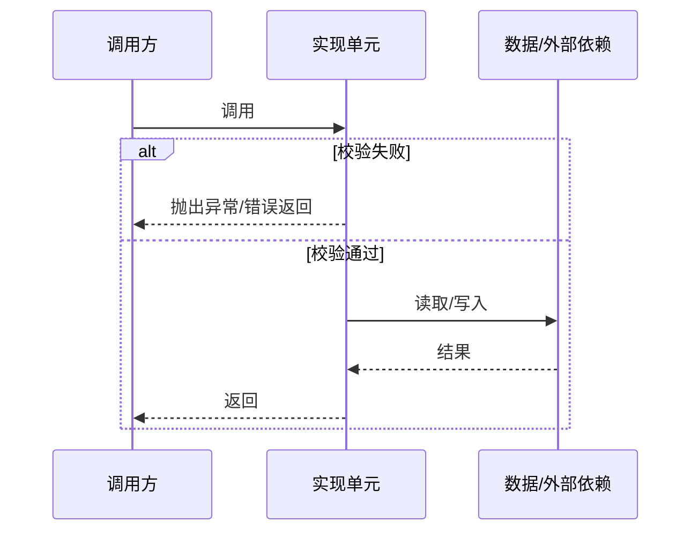

# 详细设计

**项目名称**：XXX项目
**作者**：<动态获取>
**日期**：<当前日期>
**版本**：<动态生成>

## 变更日志

| 版本 | 日期 | 作者 | 变更内容 |
|------|------|------|----------|
| <动态生成> | <当前日期> | <动态获取> | 初始版本 |

> **使用规则（生成时删除本引用块）：**
> 1. 章节固定为以下十一章，不得自由增删；本次不涉及的章节保留标题，显式写"本次无变更/不适用"及一句理由。
> 2. 面向开发人员、代码审查者：必须包含方法签名、算法伪代码、分支逻辑、异常处理、改动文件清单。
> 3. 内容归属：接口契约归 05-API文档、数据库变更归 04-数据库设计、测试用例/实测验收/回归清单归 06-测试计划，本文档不写，也不设对应章节。
> 4. 全文禁止"待确认/待补充/待实测"字样：待确认统一登记在概要设计第十二章；存在待确认项时，受影响设计按推荐默认方案编写正式设计，不在本文档标注。
> 5. 项目特有内容（如国际化词条、DOM 截图范围、样式兼容）作为第四章内的实例内容，不单设章节。
> 6. 示例为 Java，实际按项目技术栈替换；实现单元可以是类、组件、函数或模块。

## 一、文档信息

| 项目 | 内容 |
|------|------|
| 需求名称 | <需求名称> |
| 关联文档 | <同目录概要设计等> |
| 涉及仓库 | <仓库路径与分支> |

## 二、概述与设计范围

**方案定性**：[一句话方案概述，与概要设计选型结论一致]

### 2.1 设计范围

| 序号 | 范围 | 落点 |
|------|------|------|
| 1 | <改动项> | <文件/模块> |

### 2.2 核心设计约束

| 序号 | 约束 | 原因 |
|------|------|------|
| 1 | <如：既有调用契约不得变化> | <依据> |

## 三、改动文件清单

> 唯一权威清单，全文不得出现第二份；数据库变更不在此列（归 04）。

| 序号 | 文件路径 | 改动类型 | 改动要点 |
|------|----------|----------|----------|
| 1 | <路径> | <新增/修改/删除> | <要点> |

**明确不改动**：[列出易误伤的相邻文件/模块]

## 四、核心实现单元详细设计

> 每个核心类/组件/函数独立一小节，覆盖职责、关键方法签名、算法流程、分支逻辑；关键方法签名统一在本章给出。

### 4.1 <XXXService / XXX组件> 详细设计

**职责**：[一句话描述核心职责]

#### 方法：<method(params)>

**签名**：`<完整方法签名>`
**输入**：<参数含义>
**输出**：<返回含义>
**异常**：<异常类型与触发条件>

**算法流程**：
1. <初始化阶段：参数提取与校验>
2. <核心逻辑：关键步骤与分支>
3. <收尾：返回与状态恢复>

**异常处理**：

| 异常类型 | 触发条件 | 处理方式 |
|----------|----------|----------|
| <异常> | <条件> | <处理> |

## 五、关键逻辑分支详解

> 复杂分支单独展开：条件判断伪代码 + 注意事项；无复杂分支时显式声明"本次无复杂分支"及理由。

### 5.1 <分支名称>

```
IF <条件> THEN
    <处理>
ELSE
    <处理>
END IF
```

**注意事项**：
- <并发/幂等/边界等注意点>

## 六、算法说明

> 独立算法的用途、伪代码、复杂度；无独立算法时写"本次无独立算法"及理由。

### 6.1 <算法名称>

**用途**：<用途>

**伪代码**：
```
FUNCTION <name>(<params>):
    <步骤>
END FUNCTION
```

**时间复杂度**：<O(...)>
**空间复杂度**：<O(...)>

## 七、关键流程时序图

[实现级时序，含异常分支与状态恢复；与概要设计的概要流程方向不同，此处落到具体实现单元]



## 八、异常与边界处理

| 序号 | 场景 | 触发条件 | 处理策略 | 用户可见结果 |
|------|------|----------|----------|--------------|
| 1 | <场景> | <条件> | <策略> | <提示/行为> |

## 九、性能设计

> 只写设计决策（分辨率/内存/并发防护/资源释放等）；耗时预估与实测验收归 06-测试计划，不写"待实测"。

| 序号 | 维度 | 设计决策 | 依据 |
|------|------|----------|------|
| 1 | <内存/并发/资源> | <决策> | <约束或代码现状> |

## 十、配置变更

> 无配置变更时写"本次无配置变更"。

| 配置项 | 文件 | 说明 |
|--------|------|------|
| <配置> | <文件> | <说明与默认值> |

## 十一、上线与回滚方案

### 11.1 上线

| 序号 | 项 | 说明 |
|------|----|------|
| 1 | 变更类型 | <前端/后端/数据库/配置> |
| 2 | 上线顺序 | <发布顺序与依赖> |
| 3 | 灰度手段 | <开关/权限/分批> |
| 4 | 上线前检查 | <必过回归项；联调注意事项并入此处> |

### 11.2 回滚

| 序号 | 手段 | 操作 | 影响面 | 生效速度 |
|------|------|------|--------|----------|
| 1 | <手段> | <操作> | <影响> | <速度> |